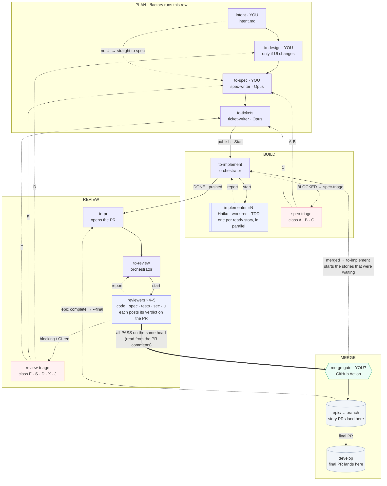
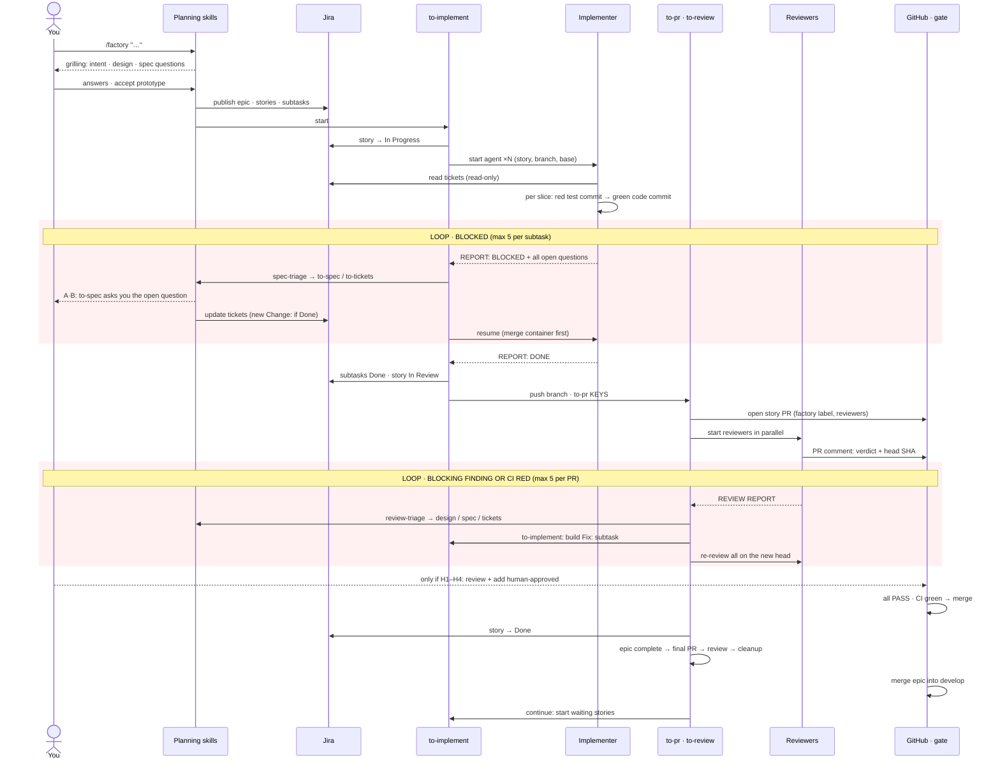
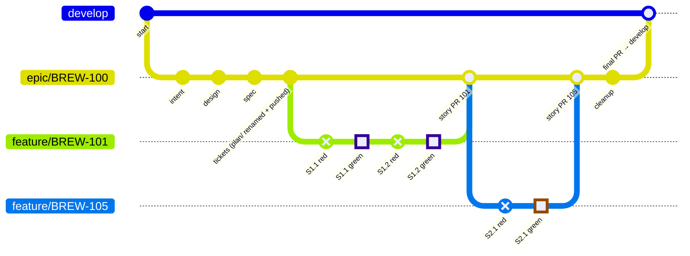

# Tessera

How a one-sentence request becomes reviewed, tested, merged code. Onboarding guide.

> This README is the Markdown copy of `docs/factory-workflow.pdf` (built from `docs/factory-workflow.html`). Keep the two in sync. Only the [Setup](#setup) section is in this README alone.

Tessera is a set of Claude Code **skills** and **subagents** in `~/.claude`. You type `/factory` and describe what you need in one sentence. Skills question ("grill") you until every decision is made, then write the intent, design, spec and Jira tickets. The spec and tickets are written by agents on **Opus 5.5 at high effort**, which ask you through your session. Cheap agents build every story test-first, in parallel. Five reviewer agents check every pull request. A GitHub Action, the **merge gate**, merges once all of them pass. When something is unclear, it goes back to the planning step that owns it. Nobody guesses.

## Five principles

1. **AI never decides.** Every product or technical decision (names, limits, messages, data shapes, libraries) goes to you as a question with a recommended answer. An agent that can't ask stops and files a blocker.
2. **Each step has one source of truth.** intent → spec → tickets. The spec is self-contained and replaces the intent. Later steps never read earlier artifacts: a gap goes back to the step that owns it.
3. **Test-first, with literal values.** Requirements are Given / when / then with exact values. Tests copy those values. Each test slice is a red commit, then a green commit.
4. **Loops, not guesses.** Implementation blockers go to `spec-triage`, review findings to `review-triage`. Each loop runs at most 5 times, then a human takes over.
5. **Machines merge, people approve.** No agent merges. The merge gate merges only when every reviewer passed the *same* commit and CI is green. Risky PRs also need your `human-approved` label.
6. **Status lines, not stories.** In a `/factory` run you see only the questions and one line per status change (`Design ✓`, `<KEY> started`, `<KEY> blocked → triage`, `PR #n security passed`, `PR #n merged`…). No explanations, loop counts or "nothing waiting" notes. Details stay in the files, Jira and the PRs.

## The four phases

| Phase | Runs | Produces | Your part |
|---|---|---|---|
| Plan | `factory` runs `intent` → `to-design` (if UI) → `to-spec` → `to-tickets`. Spec and tickets: **spec-writer** / **ticket-writer** agents (Opus 5.5, high) | intent.md, design files, spec.md, business rules, Jira epic / stories / subtasks | Answer the questions. Accept the prototype. |
| Build | `to-implement` + one **implementer** agent per story | One branch per story, built test-first: a red test commit, then a green code commit per slice | Answer the open question when a blocker needs a spec change. |
| Review | `to-pr`, `to-review` + 4–5 **reviewer** agents | PRs, each reviewer's verdict as a PR comment | Answer spec or design questions a finding raises. Review risky (H1–H4) PRs. |
| Merge | Merge gate (GitHub Action), `planning-cleanup` | Stories merged into the epic branch, then the epic merged into `develop`. Jira set to Done. | Add `human-approved` when asked. Finish stopped PRs. |

> **Start a feature:** `/factory "Users can mark a brew as favorite"`. It runs the plan phase without stopping between steps, then starts the build, which runs on by itself through PRs, reviews and merges. **Resume at any time:** `/factory` without arguments shows where every feature stands and continues the one you pick (`/factory status` only shows it). **Quiet:** a `/factory` run shows only its questions and one line per step (the files hold the details), and installs missing tools itself.
>
> **Step by step instead:** every skill still works on its own. `/intent "…"` ends by asking *Start / Later* for the next step, and so does each skill after it.

---

## Setup

Tessera installs into your Claude Code user folder, `~/.claude` (Windows: `C:\Users\<you>\.claude`), so it works in every project.

1. **Prerequisites:** [Claude Code](https://claude.com/claude-code), logged in with a claude.ai account (`/login`; the design reviews need it), and git. Everything else (Node.js, GitHub CLI, Playwright + Chromium, `designmd`, the ui-ux-pro-max plugin) `/setup-factory` installs or tells you how to.
2. **Copy the files** of this repository into `~/.claude`, keeping the folders: `agents/`, `hooks/`, `references/`, `skills/` and `docs/`. Files with the same name are replaced, everything else in `~/.claude` stays.

   ```sh
   git clone https://github.com/ntamasa/Tessera.git
   cp -r Tessera/agents Tessera/hooks Tessera/references Tessera/skills Tessera/docs ~/.claude/
   ```

3. **CLAUDE.md:** paste the content of this repository's `CLAUDE.md` into your own `~/.claude/CLAUDE.md` (create it if you have none). It holds the rules every session follows, such as the commit format in `references/commits.md`.
4. **Restart Claude Code**, so it loads the new skills and agents.
5. **Per project:** open the project and run `/setup-factory`. It checks the machine and the project, fixes the agents' guard-hook path for your machine, installs what it can, runs `/jira-setup` and `/github-setup`, and lists the steps only you can do (Jira API token, GitHub token). `/setup-factory check` only reports. Details: [One-time project setup](#one-time-project-setup).

Then start with `/factory "…"`.

---

## 1 · The Tessera loop



**Legend:** plain box = skill (runs in your session) · double-edged box = subagents (isolated worktree) · red box = triage (routes problems back) · green hexagon = GitHub merge gate · **YOU** = you decide or accept here · **YOU?** = only sometimes: the gate waits for your `human-approved` label only on PRs that need human review · dashed arrow = report back or loop back (letter = triage class).

### How to read it

- **Happy path:** intent → design → spec → tickets → implement → PR → review → gate merges into the epic branch. When every story of the epic is merged, the epic goes through one final PR into `develop`. `/factory` runs the plan row without stopping; run by hand, each skill asks *Start / Later* for the next one.
- **Build:** `to-implement` starts one implementer per ready story, all in parallel, each in its own worktree. Each one reports back **DONE** (pushed, on to `to-pr`) or **BLOCKED**.
- **Build loop:** `to-implement` hands a **BLOCKED** report to `spec-triage`, which classifies it from the evidence: **A·B** (spec gap or ambiguity) → `to-spec`, then `to-tickets`; **C** (spec clear, the ticket didn't carry it) → `to-tickets` only. Then the implementer resumes on the same branch.
- **Review loop:** a blocking finding or a red CI goes to `review-triage`: **D** (design wrong) → `to-design`, **S** (spec wrong) → `to-spec`, **F** (code wrong) → `to-tickets`. Each ends in `to-tickets`. **X** (reviewer wrong) is dismissed; **J** (judgement call) is fixed or kept, as triage decides. The fix is built as a new `Fix:` subtask (or `Change:` story), then *every* reviewer runs again.
- **Merge:** reviewers only post verdict comments. The merge gate (a GitHub Action) reads them and merges once all passed on the same head and CI is green, waiting for you only if the PR needs human review. Each merge sends Tessera back to `to-implement` for the stories that were waiting.

---

## 2 · What triggers what

| When… | …this happens | Notes |
|---|---|---|
| You run `/factory "…"` or `/intent "…"` | Grilling on the business reason, scope, constraints and success criteria → `intent.md`. It judges whether the UI changes and goes on to `to-design` or `to-spec` (`/intent` asks Start or Later first). If unsure, it asks you. | Never changed automatically: if it's wrong later, you run `intent-revise` |
| Intent changes the UI | `to-design`: grill → design screens → publish an HTML prototype → you accept → screenshots + `design-changes.md` → commit on `plan/<feature>`. | No design files yet → `design-baseline` documents the current UI first |
| Design accepted, or no UI | `to-spec` relays for its **spec-writer** agent (Opus 5.5, high): it reads the codebase, grills business gaps and technical decisions → `spec.md` (B#, R#, technical design) + `docs/business-rules.md` → commit. A decision that changes the UI **pauses** it: `to-design` runs to the end (you accept, it commits), then the spec continues. | Never runs alongside `to-design` |
| Spec written | `to-tickets` checks Jira; its **ticket-writer** agent (Opus 5.5, high) writes epic, stories (max 3 points), subtasks → Jira. Renames `plan/` to `epic/<KEY>-…` (or `bug/…`) and pushes it. | Gap in the spec → offers `to-spec` with the change request |
| Tickets published | `to-implement`: one Haiku **implementer** per *ready* story, all in parallel, each in its own worktree. Story → In Progress. | Ready = every blocking story is Done |
| Implementer reports **DONE** | Subtasks → Done, branch pushed, story → In Review → `to-pr` opens the story PR → `to-review`. | Bug: final PR straight to `develop` |
| Implementer reports **BLOCKED** | Loop count +1 (Jira label `factory-loops-n`) → `spec-triage` → A/B: `to-spec` revise → `to-tickets` update; C: `to-tickets` only → implementer resumes. | > 5 loops on a subtask → `factory-stopped` |
| PR opened | `to-review` starts the reviewers in the PR's marker in parallel (only one ui-ux at a time). Each posts its verdict comment tied to the head SHA. | Always code, spec, tests, security; + ui-ux if UI changed |
| Any finding or CI failure | PR loop +1 → `review-triage` (F / S / D / X / J) → design / spec / tickets → `to-implement` builds the fix → all reviewers again. | > 5 loops → `factory-stopped`, a human finishes it |
| Every finding dismissed (X) or kept (J) | Each finding is a review thread: the reason is replied there and the thread resolved (fixed ones are resolved once the fix is pushed). Only those reviewers re-run (same head): accept, or dispute in the thread with new evidence. | One dispute per finding; the second decision is final |
| You comment on a PR | `/factory` sends each comment to `review-triage` like a finding (your word is the decision): fixed and its thread resolved, or answered with the reason. | Doesn't count toward the loop cap |
| Diff matches H1–H4 | `needs-human-review` label. The gate waits until you review and add `human-approved`. | Never on a feature's final PR |
| All reviewers PASS on the same head | Merge gate merges (CI green, up to date, no conflict, approved if needed) → story → Done. | Gate runs on comments, PR events, every 30 min |
| Last story of the epic merged | `to-pr --final <EPIC>`: final PR `epic/…` → `develop` → full review of the whole epic. | No open story PRs allowed |
| Final PR: all reviewers PASS | `planning-cleanup` pushes the cleanup commit (only deletes planning files) → gate merges into `develop` → epic → Done. | Cleanup keeps the passes valid |
| Target branch moved on | Gate merges the target into the PR and waits for CI again. Reviewer passes stay valid. | "Update + CI only" |
| Any other new commit on a PR | Every pass becomes invalid, `human-approved` is removed, every reviewer runs again. | |
| Something merged in a review run | `to-review` calls `to-implement` (no args) → waiting stories start. | Tessera keeps moving |
| Merge conflict / CI infra failure | Reported for a human. The gate never resolves conflicts. | |

---

## 3 · One story, end to end (sequence)



Solid arrow = call / action. Dashed arrow = report or answer. Shaded frames are the two loops. Each one runs at most 5 times before the item gets `factory-stopped`.

---

## 4 · Branches and pull requests

One feature = one **container branch**. It holds the planning files first, then the merged stories. The main checkout stays on it while the feature is in Tessera.



The planning commits start on a local `plan/<feature>` branch; `to-tickets` renames it to `epic/<KEY>-…` and pushes it. `feature/BREW-105` starts only after BREW-101 is Done. Red commits (✕) hold only the test, green commits (■) the code.

| Branch | Made by | Holds | Pushed |
|---|---|---|---|
| `plan/<feature>` | first planning skill that commits, from `origin/develop` | intent, design, spec, ticket drafts | never |
| `epic/<KEY>-slug` | `to-tickets`, by renaming `plan/` | planning files, then the merged stories | yes |
| `feature/<KEY>-slug` | implementer, from the epic branch | one story's commits | yes |
| `bug/<KEY>-slug` | `to-tickets`, by renaming `plan/` (bug spec) | planning files + the bug fix (the implementer works on it directly) | yes |

| PR | From → into | Reviewers | Human rules | Cleanup |
|---|---|---|---|---|
| Story PR | `feature/…` → `epic/…` | code, spec, tests, security (+ ui-ux) | yes | no |
| Final PR, feature | `epic/…` → `develop` | all again, on the whole epic | no | yes |
| Final PR, bug | `bug/…` → `develop` | code, spec, tests, security (+ ui-ux) | yes | yes |

### The merge gate merges when…

- the PR has the `factory` label and not `factory-stopped`
- every reviewer in `<!-- factory-reviewers -->` has a `verdict=pass` comment for the **current head**
- no `needs-human-review`, or it also has `human-approved`
- a final PR contains the cleanup commit
- it's up to date with its target, CI is green and there's no conflict

### A pass stays valid only if…

every commit after the reviewed head is either a **merge of the target branch** (the gate keeps PRs up to date) or the **cleanup commit**. Any other commit means all reviewers again and removes `human-approved`.

The gate runs on PR comments, PR events and a 30-minute sweep. It uses the `FACTORY_GATE_TOKEN` secret so its merges trigger CI.

---

## 5 · Artifacts

| File | What it is | Written by | Lifetime |
|---|---|---|---|
| `intent.md` | What and why: objective, constraints (in / out of scope), checkable success criteria. Never how. | `intent`, `intent-revise` | temporary |
| `design-brief.md` | Optional: your initial design idea (style, mood, references). The intent wins on *what*, the brief on *looks*. | you | temporary |
| `design/` | `DESIGN.md` (Google Stitch tokens + components), `screens/*.md` specs, `prototype/` HTML with `?state=`, `tokens.css`, `screenshots/` | `to-design`, `design-baseline` | living |
| `design-changes.md` | What this feature changed in the design, in words, from the feature's `base_commit` | `to-design` | temporary |
| `*_deprecated.png` | "Before" screenshots of changed screens, attached to stories | `to-design` | temporary |
| `spec.md` | Self-contained build plan: Objective, Constraints, business rules **B#**, requirements **R#** (Given / when / then, literal values, failure cases), Bug section, Technical design (exact files, signatures, seams and mocks), Out of scope. IDs are stable. | `to-spec` | temporary |
| `docs/business-rules.md` | Every business rule of the product, current state only, grouped by area | `to-spec` | living |
| `tickets.json`, `tickets/` | Publish manifest + drafts. Spec sections are pulled in by heading, never copied. | `to-tickets` | temporary |

Temporary files exist only on the container branch. The cleanup commit on the final PR deletes them. Living files and code stay in `develop`.

### Jira structure

- **Epic**: one per intent. Holds the spec's objective, summary, constraints and technical design.
- **Story**: one demoable *vertical* slice (data → API → UI → tests), never one layer. Every requirement is in exactly one story. **Max 3 story points** (scale 1, 2, 3; 5+ is split).
- **Subtask**: one step, one seam, one fresh coder session: goal, read first, files, exact names, tests (happy + negative, literal values), out of scope, done when.
- **Bug**: replaces stories. Subtask 1 writes a failing reproduction test, subtask 2 fixes it without touching that test.

**Statuses:** To Do → **In Progress** (implementer starts) → **In Review** (DONE, branch pushed) → **Done** (PR merged). Epic → Done when the final PR merges.

**Done is frozen.** A Done issue is never edited. A change to Done work becomes a **new** issue that goes through the whole loop:

- Done subtask → new `Change: …` / `Fix: …` subtask under its story
- Done story → new `Change: …` story under the epic, blocked by the Done one

Jira is only accessed through `skills/jira/scripts/jira.mjs` (never MCP). Config comes from the project's `.env`.

### Triage classes (the triage decides; unsure → the class that goes back further)

| spec-triage: implementer blockers | |
|---|---|
| A | Spec gap or conflict → `to-spec` → `to-tickets` |
| B | Ambiguous spec → `to-spec` → `to-tickets` |
| C | Clear spec, ticket missed it → `to-tickets` |

| review-triage: findings | |
|---|---|
| F | Code wrong → new `Fix:` subtask |
| S | Spec wrong or silent → `to-spec` → `to-tickets` |
| D | Design wrong → `to-design` → spec → tickets |
| X | Finding wrong (clear evidence) → dismissed, reason replied in its thread |
| J | Judgement call → triage fixes it (`Fix:`) or keeps the code, reason replied in its thread |

---

## 6 · Agents and guardrails

| Agent | Model | Job |
|---|---|---|
| spec-writer | Opus 5.5 high | Writes or revises the spec and business rules for `to-spec`, grilling you through the relay. |
| ticket-writer | Opus 5.5 high | Breaks the spec into epic, stories and subtasks and publishes them for `to-tickets`. |
| installer | Haiku 5.5 | Installs or upgrades a tool a step needs (Node.js, Playwright, `designmd`…) and answers in one line, so installs stay out of your session. |
| implementer | Haiku 5.5 | Builds the subtasks of one story with the `tdd` skill: red test commit, green code commit, whole suite green. Checks every subtask before coding and reports all open questions at once. |
| reviewer-code | Sonnet 5.5 | Documented standards, fit with the spec's technical design, error handling. Fowler code smells as judgement findings. |
| reviewer-spec | Sonnet 5.5 | Does the code do what the requirements and business rules say? Checks for missing, wrong and scope-creep behavior. |
| reviewer-tests | Sonnet 5.5 | Every requirement proven with literal values, negative cases, right seams and mocks, no weakened tests. Runs the suite and checks red before green. |
| reviewer-security | Opus 5.5 | Injection, XSS, authz / IDOR, data exposure, input limits, secrets, web settings, dependencies. Always escalates security features (H2). |
| reviewer-ui-ux | Sonnet 5.5 | Runs the app with Playwright and compares every state with the design files. Checks flows, feedback and accessibility. Marks problems the design itself causes "(design)". |

**The relay:** agents can't ask you anything themselves. The spec and ticket agents end every message with a `relay` block; `to-spec` / `to-tickets` ask you exactly those questions and send your answers back to the same agent, word for word (`references/relay.md`). They are agents because a skill's `model` setting is ignored when another skill calls it, and they work in your main checkout. The implementer and reviewers each run in their own git worktree. Reviewers are report-only: every finding blocks. A **rule** finding breaks a requirement, test proof, data safety, the design or a documented standard; a **judgement** finding (max 5) breaks nothing written but is worth changing. No nits. No evidence (`path:line` + quoted source), no finding.

### Hard guardrails (agent-guard hook)

- No agent merges, approves, edits, closes or labels a PR. Only reviewers may comment.
- Agents only *read* Jira. The orchestrators update it.
- **Red-test lock:** while HEAD is a red commit (marked with a git note in `refs/notes/factory-red`), its files can't be edited, and the commit can't be amended or soft-reset. You make the test pass by changing code, never the test.

### Loop caps

- \> 5 blocked reports on one subtask, or > 5 review loops on one PR → `factory-stopped`. The gate never merges it, and a human finishes it. To retry a stopped Jira item, remove the label.

### Human review rules

| | |
|---|---|
| H1 | **Irreversible:** destructive migrations, permanent deletes, outbound email / SMS / payment / webhooks |
| H2 | **Security feature:** auth, roles, sessions, tokens, crypto, secrets, CORS / CSP, rate limits |
| H3 | **Infra / CI / Tessera config:** `.github/`, Docker, deploy, `.claude/`, CLAUDE.md, `.env.example` |
| H4 | **Contract or data:** breaking API change, money / billing, personal data |

When unsure, the rule applies. GitHub won't let you approve your own PR, so your approval is the `human-approved` label.

---

## 7 · Setup, your role, cheat sheet

### One-time project setup

- **Jira:** `/jira-setup` → `.env` with `JIRA_BASE_URL`, `JIRA_EMAIL`, `JIRA_API_TOKEN` (you paste it), `JIRA_PROJECT_KEY`. `.env` is git-ignored, and `.env.example` lists the variables.
- **GitHub:** `/github-setup` → gh login, remote, a `develop` branch, labels, Actions on, the `FACTORY_GATE_TOKEN` secret (a fine-grained PAT with Contents + Pull requests read/write), a CI workflow on `pull_request`, and the merge gate workflow on the default branch *and* `develop` (you merge those PRs yourself).
- **Repo:** `.gitignore` ignores `.claude/worktrees/`, and `.worktreeinclude` lists `.env`.
- **Everything at once:** `/setup-factory` checks the machine and the project, installs what it can without asking (through the **installer** agent: Playwright + Chromium, `designmd`, the ui-ux-pro-max plugin; plus the repo files), runs `jira-setup` and `github-setup`, and lists the steps only you can do. `/setup-factory check` only reports.
- **Existing UI, no design files:** `/design-baseline` documents it as it is.

### Your role (the human)

- Answer grilling questions. Every one comes with a recommendation.
- Accept or change the prototype. The spec is accepted by default: ask for changes when you want them.
- Review `needs-human-review` PRs and add `human-approved`, or comment what to change and run `/factory`.
- Finish `factory-stopped` items and merge conflicts.
- Close Jira tickets Tessera lists as no longer needed. It never deletes issues.

### Commands

| Command | Does |
|---|---|
| `/factory "…"` | start a feature or bug, run it all |
| `/factory [path \| key \| status]` | where things stand, continue one |
| `/setup-factory [check]` | set up or check Tessera |
| `/intent "…"` | start step by step |
| `/intent-revise <path> "…"` | change an intent |
| `/to-design [intent]` | design the UI |
| `/to-spec [intent] ["change"]` | write or revise the spec |
| `/to-tickets [spec]` | publish or update tickets |
| `/to-implement [keys]` | build ready stories (no args: everything open) |
| `/to-pr [keys \| --final EPIC]` | open PRs |
| `/to-review [PRs]` | review open factory PRs |
| `/planning-cleanup <PR>` | finish a final PR by hand |

### Labels

| Label | Meaning |
|---|---|
| `factory` | opened by Tessera, the gate watches it |
| `needs-human-review` | matched H1–H4 |
| `human-approved` | you reviewed it (removed on every new push) |
| `factory-loops-n` | loop count (PR, or a Jira subtask) |
| `factory-stopped` | loop cap hit, a human finishes it |

### Known limits

- Parallel agents share one `.env`: the same database and ports. Tests that need exclusive resources can collide.
- The gate never resolves merge conflicts.
