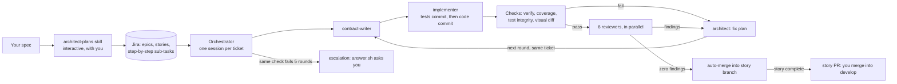

# Tessera
Autonomous AI development workflow that turns specs into reviewed, tested pull requests one ticket at a time, and escalates to a human only when stuck.

Tessera is the **workflow repository**: it knows *how to work* (the pipeline, the fix loop, the
gates, the review rules, the escalation procedure, which model each agent runs on) and never
mentions a language or framework. Everything about a project (stack, layout, commands,
conventions, test levels, coverage gates) lives in that **target repository's `AGENTS.md`**.
Tessera works on one or more target repositories from an isolated Docker container, on a
nightly schedule, under your own GitHub and Jira accounts.

Your part: write specs, plan each epic interactively, answer escalations when asked, review and
merge each finished story into `develop`, and merge `develop` into `main` when you release.

## How it works



- **Phase 1, planning (with you).** `bin/plan.sh` opens the `architect-plans` skill on a spec.
  It asks only genuine questions, writes plain-language stories and sub-tasks that are
  step-by-step guides a low-tier model can follow, and creates the Jira tickets once you approve.
- **Phase 2, the daily run (headless).** Cron starts `bin/run-daily.sh`, which starts a fresh
  orchestrator session per ticket. The orchestrator runs the contract-writer and the
  implementer (tests first, then code), checks every gate itself, and runs the reviewers. Any
  failure goes to the `architect` agent, which writes a fix plan for the next round on the same
  ticket. Reviewer findings become inline PR comments, as documentation only. After 5
  consecutive failures of the same check, the ticket escalates: a `[BLOCKED]` draft PR, and a
  question waiting for you in the answer session.
- **Merging.** Sub-tasks auto-merge into their `story/<KEY>` branch once checks and reviewers
  pass. When a story is complete, the orchestrator opens the story PR into `develop`, and you
  review and merge it. Only you merge into `develop` and `main`.

## Repository layout

```
Tessera/
├── Dockerfile, docker-compose.yml   # the sandbox: stack-neutral tooling, non-root user
├── .env                             # AGENT_CLI (which adapter) and AGENT_UID
├── secrets.env.example              # copy to secrets.env (git-ignored) and fill in
├── projects.yaml                    # target repos to work on, with their Jira project keys
├── package.json                     # Playwright, pixelmatch, pngjs, axe for the UI scripts
├── adapters/claude-code/            # the Claude Code adapter (see "Adapters")
├── agent/                           # CLI-neutral sources the adapter installs
│   ├── rules.md                     # workflow rules for every agent in every project
│   ├── policy.yaml                  # allow-all mode, deny list, pre-edit hook
│   ├── mcp.yaml                     # Jira (mcp-atlassian) and Playwright MCP servers
│   ├── agents/                      # 10 subagents, each with its own model and effort
│   ├── skills/                      # architect-plans, escalation, answer
│   └── hooks/guard.sh               # blocks edits the workflow must never make
├── prompts/orchestrator.md          # the orchestrator's instructions (model in front matter)
├── templates/                       # AGENTS.md for onboarding; story, sub-task, PR, escalation bodies
├── bin/
│   ├── agent                        # dispatches to adapters/$AGENT_CLI/agent
│   ├── bootstrap.sh                 # installs config at the start of every run
│   ├── run-daily.sh                 # the nightly loop (cron)
│   ├── orchestrate.sh               # one orchestrator session for one ticket
│   ├── check-feedback.sh            # resumes answered escalations (cron, every 30 min)
│   ├── plan.sh, answer.sh           # your two interactive sessions
│   ├── wf-config, frontmatter       # readers for the AGENTS.md config block and front matter
│   ├── check-test-integrity.sh      # test count and skip check, in CI and in the pipeline
│   ├── jira-comment.sh              # posts a fix round's summary on the ticket
│   ├── diff-hunks                   # hunk ranges and the reviewer anchor check
│   ├── post-review.sh               # posts one reviewer's round as an inline-comment review
│   ├── push-evidence.sh             # publishes screenshots to the agent-evidence branch
│   ├── design-diff.mjs              # the visual check's gate
│   ├── a11y-scan.mjs                # axe scan for the accessibility reviewer
│   └── lib/ui.mjs                   # shared helpers of the two UI scripts
├── workspace/                       # git-ignored; mounted as /workspace in the container
└── .github/
    ├── scripts/check-workflow.sh    # this repo's static checks (run locally or in CI)
    └── workflows/
        ├── ci.yml                   # runs check-workflow.sh
        └── test-integrity.yml       # reusable workflow every target repo's CI calls
```

## Agents and models

Every agent's model and effort are set in its own file's front matter, and nothing changes them
at run time: a failure starts a fix round, never a stronger model. To change one, edit the front
matter and merge; the next run's `bootstrap.sh` installs it.

| Agent | File | Model | Effort |
|---|---|---|---|
| orchestrator (also runs the escalation skill) | `prompts/orchestrator.md` | Opus 5.5 | medium |
| architect-plans (skill) | `agent/skills/architect-plans/SKILL.md` | Fable 5.1 | medium |
| architect | `agent/agents/architect.md` | Fable 5.1 | medium |
| contract-writer | `agent/agents/contract-writer.md` | Haiku 5.5 | medium |
| implementer | `agent/agents/implementer.md` | Haiku 5.5 | medium |
| visual-verifier | `agent/agents/visual-verifier.md` | Sonnet 5.5 | medium |
| review-quality | `agent/agents/review-quality.md` | Sonnet 5.5 | max |
| review-functionality | `agent/agents/review-functionality.md` | Sonnet 5.5 | medium |
| review-security | `agent/agents/review-security.md` | Sonnet 5.5 | high |
| review-test-integrity | `agent/agents/review-test-integrity.md` | Sonnet 5.5 | max |
| review-contract | `agent/agents/review-contract.md` | Sonnet 5.5 | low |
| review-accessibility | `agent/agents/review-accessibility.md` | Sonnet 5.5 | low |

The escalation and answer skills have no model: escalation runs in the orchestrator's session,
the answer session on the CLI's default model.

## Setup

### What you need
- An always-on machine with Docker and ~50 GB free disk (16 GB RAM is a comfortable start).
- An LLM plan that allows unattended headless use of your agent CLI. For Claude Code, generate a
  long-lived token once with `claude setup-token`, or use an API key.
- A **fine-grained GitHub token** on your own account, scoped to this repo and every target
  repo: Contents (rw), Pull requests (rw), Commit statuses (rw), Actions (r), Metadata (r).
- A **Jira Cloud** site and an API token for your account (id.atlassian.com → Security → API
  tokens).

The agents act as you: every PR, commit, comment and Jira transition appears under your name.
GitHub can't tell them from you, so the deny list in `agent/policy.yaml` and the orchestrator's
rules are what keep them from merging into `develop` or `main`.

### First-time setup (on the host)

```bash
git clone https://github.com/ntamasa/Tessera.git ~/tessera
cd ~/tessera
cp secrets.env.example secrets.env        # fill it in
id -u                                     # if not 1000, set AGENT_UID in .env to this value
mkdir -p workspace && docker compose build
docker compose run --rm agent bash -c \
  'gh auth setup-git && git clone https://github.com/ntamasa/Tessera.git /workspace/workflow \
   && /workspace/workflow/bin/bootstrap.sh'
```

The container works on its own clone of this repo (`/workspace/workflow`) and pulls `main` at the
start of every nightly run, so changes reach it only once you merge them to `main`. Protect
`main`: require PRs and the `ci` check.

If a target project's tests or app start containers, the agent user needs access to the mounted
Docker socket; if the container's `docker` group ID differs from the host's, add a
`group_add: ["<host docker GID>"]` entry to the service in `docker-compose.yml`.

### Scheduling (host crontab)

```cron
0 1 * * *    cd ~/tessera && docker compose run --rm agent /workspace/workflow/bin/run-daily.sh
*/30 * * * * cd ~/tessera && docker compose run --rm agent /workspace/workflow/bin/check-feedback.sh
```

Don't enable cron on day one; follow the rollout below. Back up `~/tessera/workspace/data`: state,
fix plans and escalation records live there, outside every git repo.

## Onboarding a target repository

Once per project:

1. **`AGENTS.md`**: copy `templates/AGENTS.md` to the target repo's root and fill it in. The
   "Agent workflow config" block is what every script and hook reads. Check it with
   `bin/wf-config <repo>` and test `case_pattern` / `skip_pattern` with `git grep -E`.
2. **`mise.toml`**: pin every tool the project needs; make `setup` run `mise install` plus the
   dependency install.
3. **Walking skeleton**: at least one real example of each kind of code and each test level
   `AGENTS.md` names. Agents copy patterns.
4. **Branches**: `main` and `develop` protected (require PR, required checks, no force-push);
   a rule on `story/*` that also requires `agent-review`; enable *Allow auto-merge* and
   *Automatically delete head branches*.
5. **CI**: the project's own jobs under the names in `required_checks`, plus
   ```yaml
   test-integrity:
     uses: ntamasa/Tessera/.github/workflows/test-integrity.yml@main
   ```
   If Tessera is private, allow access to its workflows (Settings → Actions → General → Access).
6. **Jira**: a Scrum project with `To Do → In Progress → In Review → Done` (and
   `In Review → In Progress`), labels `agent-ready` and `comp-<name>` per component.
7. **`projects.yaml`**: add the repo, its Jira key and a daily ticket budget.
8. Create `docs/spec/`, and `design/` if the project has a UI.

## Daily use

| You want to… | Run (from `~/tessera`) |
|---|---|
| Plan a new epic from a spec | `docker compose run --rm agent /workspace/workflow/bin/plan.sh <project> docs/spec/<spec>.md` |
| Answer escalations | `docker compose run --rm agent /workspace/workflow/bin/answer.sh` |
| See what happened last night | `workspace/data/logs/<date>/summary.log` |
| Request changes to a finished story | add a sub-task under the story in Jira, labelled `agent-ready` |
| Change how the workflow works | a PR to this repo, merged to `main` |

You never answer on GitHub or Jira: nothing in the workflow reads PR comments. Escalations reach
you as a push notification (Claude Code, best effort) or as `result=escalated` in the summary log.

## Rollout

1. **Foundation**: tokens, container, `bootstrap.sh`, branch protection on this repo.
2. **First target repo**: something small; `AGENTS.md`, `mise.toml`, walking skeleton, CI, Jira.
3. **Test the guards**: inside the container, from the target repo, run
   `AGENT_AUTONOMOUS=1 /workspace/workflow/bin/agent interactive` and ask an agent to skip a
   test, edit a generated file and edit `AGENTS.md`. All three must be blocked.
4. **Plan a tiny epic** (2–3 stories) with `plan.sh`.
5. **Supervised runs**: run the orchestrator interactively on 2–3 tickets
   (`AGENT_AUTONOMOUS=1 /workspace/workflow/bin/agent interactive --model claude-opus-5-5 --effort medium`,
   then paste a header and `prompts/orchestrator.md`). Confirm models, token figures, gates,
   fix plans, Jira comments, inline review comments, auto-merge, the story PR and an escalation
   round trip through `answer.sh`.
6. **Headless**: run `run-daily.sh` once by hand, then enable cron.
7. **Tune** after ~15 tickets: improve tickets and `AGENTS.md` first, models last.

## Adapters

The workflow never calls an agent CLI directly. `bin/agent` dispatches to
`adapters/$AGENT_CLI/agent` (`AGENT_CLI` in `.env`). To support another CLI, add a folder with:

| Entry point | Does |
|---|---|
| `install-cli.sh` | Installs the CLI at image build (root); links a system-wide policy file if the CLI has one |
| `agent install` | Translates `agent/` into the CLI's formats: rules → global instructions, agents (keeping `model` and `effort`), skills, policy → permissions + pre-edit hook, MCP servers |
| `agent run --model --effort --prompt-file --output` | One headless session with all permissions; writes `{"is_error", "limit_hit", "usage": {"input_tokens", "output_tokens"}}` |
| `agent interactive [--model] [--effort] [--prompt]` | An interactive session |
| `agent notify-support` | Prints `available` or `unavailable` |

plus a hook shim that turns the CLI's pre-edit payload into `{"path", "content"}` for
`agent/hooks/guard.sh`. Agent files name CLI-neutral tool groups (`read`, `search`, `edit`,
`shell`, `browser`, `jira`), which the adapter maps to the CLI's tool names.

The Claude Code adapter keeps the CLI's config in the `agent-state` volume
(`CLAUDE_CONFIG_DIR`), installs the policy as Claude Code's managed settings so a target repo
can't loosen it, and stores the Jira MCP credentials in that volume's config.

## Differences from the setup guide

The implementation follows the "Autonomous dev workflow guide", with these deliberate changes:

- **Guard hook**: with no active ticket it allows writes only to the data folder (the guide's
  version allowed any path when `current.json` was missing), and a component's `skip_pattern`
  applies only to files under its `tests.paths`.
- **Test-integrity check**: an invalid regex fails instead of silently counting zero, and an
  empty `skip_pattern` no longer matches every line.
- **Deterministic helpers** for steps the guide leaves to the orchestrator: `diff-hunks` (anchor
  check), `post-review.sh` (inline review comments), `push-evidence.sh` (screenshots on the
  `agent-evidence` branch), and `a11y-scan.mjs` (the accessibility reviewer's axe run).
- **Resume targeting**: `check-feedback.sh` tells each orchestrator session which answered
  ticket to resume.
- **Container**: the agent user's UID is configurable (`AGENT_UID`) so the `./workspace` bind
  mount is writable, and Playwright MCP is pinned to Chromium, the only browser in the image.
- **Self-contained prompts**: the orchestrator prompt and agents inline the parts of the guide
  they refer to (review stage, resume procedure, how steps are written), since agents can't
  read the guide.

## Development

Run the repo's own checks before opening a PR (needs `shellcheck`, `jq`, `yq` and `node`):

```bash
.github/scripts/check-workflow.sh
```

Work on feature branches and open PRs into `develop`; `develop` is merged into `main` to release
a new workflow version to the container.
