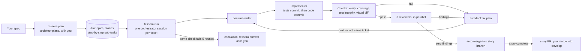

# Tessera
Autonomous AI development workflow that turns specs into reviewed, tested pull requests one ticket at a time, and escalates to a human only when stuck.

Tessera is the **workflow repository**: it knows *how to work* (the pipeline, the fix loop, the
gates, the review rules, the escalation procedure, which model each agent runs on) and never
mentions a language or framework. Everything about a project (stack, layout, commands,
conventions, test levels, coverage gates, its Jira project) lives in that **project's own
`AGENTS.md`**.

You start Tessera **from inside the project** it should work on. It runs in an isolated Docker
container on that project's folder, under your own GitHub and Jira accounts, and knows nothing
about any other project. Start it from a second project and the two run side by side.

Your part: write specs, plan each epic with Tessera, answer escalations when asked, review and
merge each finished story into `develop`, and merge `develop` into `main` when you release.

> [!IMPORTANT]
> **Before you use Tessera, set its environment variables on your machine.** Tessera keeps no
> configuration or secrets in files or on GitHub: every token comes from environment variables
> you create on your own PC. Nothing works until they are set. See [Configuration](#configuration).

## How it works



- **Planning (with you).** `tessera plan <spec>` opens the `architect-plans` skill on a spec.
  It asks only genuine questions, writes plain-language stories and sub-tasks that are
  step-by-step guides a low-tier model can follow, and creates the Jira tickets once you approve.
- **The autonomous run (headless).** `tessera run` (by hand or from a scheduler) works the
  project's ready tickets one by one, with a fresh orchestrator session per ticket. The
  orchestrator runs the contract-writer and the implementer (tests first, then code), checks
  every gate itself, and runs the reviewers. Any failure goes to the `architect` agent, which
  writes a fix plan for the next round on the same ticket. Reviewer findings become inline PR
  comments, as documentation only. After 5 consecutive failures of the same check, the ticket
  escalates: a `[BLOCKED]` draft PR, and a question waiting for you in `tessera answer`.
- **Merging.** Sub-tasks auto-merge into their `story/<KEY>` branch once checks and reviewers
  pass. When a story is complete, the orchestrator opens the story PR into `develop`, and you
  review and merge it. Only you merge into `develop` and `main`.

You work on a project *through* Tessera, not next to it: a run switches branches and commits in
the project folder, so Tessera refuses to start on uncommitted changes, and only one Tessera
container runs per project at a time. When a run ends, the folder is back on `develop`, clean.

## Configuration

> [!IMPORTANT]
> Create these as **environment variables on your PC**, for your user account. They are never
> written to a file, committed, or uploaded to GitHub. `bin/tessera` reads them when it starts and
> passes them into the container; it lists any that are missing and refuses to start.

| Variable | Required | What it is |
|---|---|---|
| `TESSERA_GH_TOKEN` | yes | A **fine-grained GitHub token** on your own account, scoped to Tessera and every project repo: Contents (rw), Pull requests (rw), Commit statuses (rw), Actions (r), Metadata (r) |
| `TESSERA_JIRA_URL` | yes | Your Jira Cloud site, e.g. `https://yoursite.atlassian.net` |
| `TESSERA_JIRA_USERNAME` | yes | The email of your Atlassian account |
| `TESSERA_JIRA_API_TOKEN` | yes | An API token from id.atlassian.com → Security → API tokens |
| `TESSERA_CLAUDE_CODE_OAUTH_TOKEN` | one of these two | A long-lived Claude token, generated once with `claude setup-token` (uses your Claude subscription) |
| `TESSERA_ANTHROPIC_API_KEY` | | Or an Anthropic API key (API billing) |
| `TESSERA_GIT_NAME`, `TESSERA_GIT_EMAIL` | no | Commit author; defaults to your own `git config user.name` / `user.email` |
| `TESSERA_AGENT_CLI` | no | Which adapter to use; defaults to `claude-code` |

All names start with `TESSERA_` on purpose. A plain `GH_TOKEN` or `ANTHROPIC_API_KEY` set
system-wide would take over your own `gh` and `claude` on the same machine. Inside the container
they are passed on under their real names (`GH_TOKEN`, `JIRA_API_TOKEN`, …).

**Windows**: Settings → System → About → Advanced system settings → Environment Variables →
*User variables* → New, once per variable; or in PowerShell, once per variable:

```powershell
[Environment]::SetEnvironmentVariable("TESSERA_GH_TOKEN", "github_pat_...", "User")
```

Open a new terminal afterwards so it sees them.

**Linux / macOS**: add `export TESSERA_GH_TOKEN=...` lines to `~/.profile` (not `~/.bashrc`:
scheduled runs don't read it) and keep that file readable only by you (`chmod 600 ~/.profile`).

The agents act as you: every PR, commit, comment and Jira transition appears under your name.
GitHub can't tell them from you, so the deny list in `agent/policy.yaml` and the orchestrator's
rules are what keep them from merging into `develop` or `main`. Revoking access means revoking
the GitHub and Jira tokens.

## Setup

### What you need
- A machine with Docker (Docker Desktop on Windows or macOS) and ~50 GB free disk;
  16 GB RAM is a comfortable start.
- Bash to run `bin/tessera`: Git Bash on Windows, any terminal on Linux and macOS.
- An LLM plan that allows unattended headless use of your agent CLI.
- A Jira Cloud site.
- The [environment variables](#configuration) above.

### Install

```bash
git clone https://github.com/ntamasa/Tessera.git ~/tessera
```

Keep this checkout on `main`: `bin/tessera` builds the container image from it on every start
(cached, so only changes are rebuilt), so whatever is checked out is the workflow version your
projects run. Optionally put `~/tessera/bin` on your `PATH` to type `tessera` instead of
`~/tessera/bin/tessera`.

Protect Tessera's own `main`: require PRs and the `ci` check.

### Using it

From inside a project folder (any subfolder works):

| You want to… | Run |
|---|---|
| Plan a new epic from a spec | `tessera plan docs/spec/<spec>.md` |
| Let it work through the ready tickets | `tessera run` |
| Answer escalations | `tessera answer` (answered tickets resume as soon as you close it) |
| Resume answered escalations | `tessera resume` |
| Get a shell in the project's container | `tessera shell` |
| See what a run did | `~/tessera/workspace/<project>/logs/<date>/summary.log` |
| Request changes to a finished story | add a sub-task under the story in Jira, labelled `agent-ready` |
| Change how the workflow works | a PR to this repo, merged to `main` |

Each project's state, fix plans, escalation records, screenshots and logs live in
`~/tessera/workspace/<project>/`, outside every git repo. Back that folder up.

You never answer on GitHub or Jira: nothing in the workflow reads PR comments. Escalations reach
you as a push notification (Claude Code, best effort) or as `result=escalated` in the summary log.

### Scheduling

A scheduled run works exactly like typing the command in the project folder. Don't schedule
anything on day one; follow the rollout below.

**Linux / macOS** (`crontab -e`), one pair of lines per project; `bash -lc` loads `~/.profile`
so the environment variables are set:

```cron
0 1 * * *    bash -lc 'cd ~/code/my-app && ~/tessera/bin/tessera run'
*/30 * * * * bash -lc 'cd ~/code/my-app && ~/tessera/bin/tessera resume'
```

**Windows**: in Task Scheduler, create a task per project that runs
`"C:\Program Files\Git\bin\bash.exe" -lc "cd /c/code/my-app && ~/tessera/bin/tessera run"`
nightly (and one with `resume` every 30 minutes), "Run only when user is logged on", so it sees
your user environment variables and Docker Desktop.

## Onboarding a project

Once per project:

1. **`AGENTS.md`**: copy `templates/AGENTS.md` to the project's root and fill it in, including
   `jira_project`. The "Agent workflow config" block is what every script and hook reads. Check
   it with `/workspace/workflow/bin/wf-config .` inside `tessera shell`, and test `case_pattern` /
   `skip_pattern` with `git grep -E`.
2. **`mise.toml`**: pin every tool the project needs; make `setup` run `mise install` plus the
   dependency install.
3. **Walking skeleton**: at least one real example of each kind of code and each test level
   `AGENTS.md` names. Agents copy patterns.
4. **Branches**: `main` and `develop` protected (require PR, required checks, no force-push);
   a rule on `story/*` that also requires `agent-review`; enable *Allow auto-merge* and
   *Automatically delete head branches*.
5. **CI**: the project's own jobs under the names in `required_checks`, plus
   ```yaml
   test-integrity:
     uses: ntamasa/Tessera/.github/workflows/test-integrity.yml@main
   ```
   If Tessera is private, allow access to its workflows (Settings → Actions → General → Access).
6. **Jira**: a Scrum project with `To Do → In Progress → In Review → Done` (and
   `In Review → In Progress`), labels `agent-ready` and `comp-<name>` per component.
7. **Token**: add the repo to your fine-grained `TESSERA_GH_TOKEN`.
8. Create `docs/spec/`, and `design/` if the project has a UI.
9. On Windows, add a `.gitattributes` with `* text=auto eol=lf` so files keep the same line
   endings whether your git or the container's writes them.

## Rollout

1. **Foundation**: environment variables, Tessera checkout, branch protection on this repo.
2. **First project**: something small; `AGENTS.md`, `mise.toml`, walking skeleton, CI, Jira.
3. **Test the guards**: `tessera shell`, then `AGENT_AUTONOMOUS=1 /workspace/workflow/bin/agent interactive`,
   and ask an agent to skip a test, edit a generated file and edit `AGENTS.md`. All three must
   be blocked.
4. **Plan a tiny epic** (2–3 stories) with `tessera plan`.
5. **Supervised runs**: in `tessera shell`, run the orchestrator interactively on 2–3 tickets
   (`AGENT_AUTONOMOUS=1 /workspace/workflow/bin/agent interactive --model claude-opus-5-5 --effort medium`,
   then paste a header and `prompts/orchestrator.md`). Confirm models, token figures, gates,
   fix plans, Jira comments, inline review comments, auto-merge, the story PR and an escalation
   round trip through `tessera answer`.
6. **Headless**: run `tessera run` once by hand, then schedule it.
7. **Tune** after ~15 tickets: improve tickets and `AGENTS.md` first, models last.

## Agents and models

Every agent's model and effort are set in its own file's front matter, and nothing changes them
at run time: a failure starts a fix round, never a stronger model. To change one, edit the front
matter and merge; the next start rebuilds the image with it.

| Agent | File | Model | Effort |
|---|---|---|---|
| orchestrator (also runs the escalation skill) | `prompts/orchestrator.md` | Opus 5.5 | medium |
| architect-plans (skill) | `agent/skills/architect-plans/SKILL.md` | Fable 5.1 | medium |
| architect | `agent/agents/architect.md` | Fable 5.1 | medium |
| contract-writer | `agent/agents/contract-writer.md` | Haiku 5.5 | medium |
| implementer | `agent/agents/implementer.md` | Haiku 5.5 | medium |
| visual-verifier | `agent/agents/visual-verifier.md` | Sonnet 5.5 | medium |
| review-quality | `agent/agents/review-quality.md` | Sonnet 5.5 | max |
| review-functionality | `agent/agents/review-functionality.md` | Sonnet 5.5 | medium |
| review-security | `agent/agents/review-security.md` | Sonnet 5.5 | high |
| review-test-integrity | `agent/agents/review-test-integrity.md` | Sonnet 5.5 | max |
| review-contract | `agent/agents/review-contract.md` | Sonnet 5.5 | low |
| review-accessibility | `agent/agents/review-accessibility.md` | Sonnet 5.5 | low |

The escalation and answer skills have no model: escalation runs in the orchestrator's session,
the answer session on the CLI's default model.

## Repository layout

```
Tessera/
├── Dockerfile, docker-compose.yml   # the sandbox; Tessera itself is baked into the image
├── package.json                     # Playwright, pixelmatch, pngjs, axe for the UI scripts
├── adapters/claude-code/            # the Claude Code adapter, incl. its credential list (env)
├── agent/                           # CLI-neutral sources the adapter installs
│   ├── rules.md                     # workflow rules for every agent in every project
│   ├── policy.yaml                  # allow-all mode, deny list, pre-edit hook
│   ├── mcp.yaml                     # Jira (mcp-atlassian) and Playwright MCP servers
│   ├── agents/                      # 10 subagents, each with its own model and effort
│   ├── skills/                      # architect-plans, escalation, answer
│   └── hooks/guard.sh               # blocks edits the workflow must never make
├── prompts/orchestrator.md          # the orchestrator's instructions (model in front matter)
├── templates/                       # AGENTS.md for onboarding; story, sub-task, PR, escalation bodies
├── bin/
│   ├── tessera                      # the launcher you run from a project (on your machine)
│   ├── agent                        # dispatches to adapters/$AGENT_CLI/agent (in the container)
│   ├── bootstrap.sh                 # installs the agent config at the start of every container
│   ├── run-daily.sh                 # `tessera run`: one orchestrator session per ticket
│   ├── orchestrate.sh               # one orchestrator session for one ticket
│   ├── check-feedback.sh            # `tessera resume`: resumes answered escalations
│   ├── plan.sh, answer.sh           # `tessera plan` and `tessera answer`
│   ├── wf-config, frontmatter       # readers for the AGENTS.md config block and front matter
│   ├── check-test-integrity.sh      # test count and skip check, in CI and in the pipeline
│   ├── jira-comment.sh              # posts a fix round's summary on the ticket
│   ├── diff-hunks                   # hunk ranges and the reviewer anchor check
│   ├── post-review.sh               # posts one reviewer's round as an inline-comment review
│   ├── push-evidence.sh             # publishes screenshots to the agent-evidence branch
│   ├── design-diff.mjs              # the visual check's gate
│   ├── a11y-scan.mjs                # axe scan for the accessibility reviewer
│   └── lib/ui.mjs                   # shared helpers of the two UI scripts
├── workspace/<project>/             # git-ignored; each project's data, mounted as /workspace/data
└── .github/
    ├── scripts/check-workflow.sh    # this repo's static checks (run locally or in CI)
    └── workflows/
        ├── ci.yml                   # runs check-workflow.sh
        └── test-integrity.yml       # reusable workflow every project's CI calls
```

Inside a project's container: the project folder is `/workspace/project`, its data folder
`/workspace/data`, and Tessera `/workspace/workflow` (read-only to agents).

## Adapters

The workflow never calls an agent CLI directly. `bin/agent` dispatches to
`adapters/$AGENT_CLI/agent` (`TESSERA_AGENT_CLI`, default `claude-code`). To support another CLI,
add a folder with:

| Entry point | Does |
|---|---|
| `env` | The credentials it needs, one per line (`A\|B` = either); `bin/tessera` passes `TESSERA_<NAME>` in as `<NAME>` |
| `install-cli.sh` | Installs the CLI at image build (root); links a system-wide policy file if the CLI has one |
| `agent install` | Translates `agent/` into the CLI's formats: rules → global instructions, agents (keeping `model` and `effort`), skills, policy → permissions + pre-edit hook, MCP servers |
| `agent run --model --effort --prompt-file --output` | One headless session with all permissions; writes `{"is_error", "limit_hit", "usage": {"input_tokens", "output_tokens"}}` |
| `agent interactive [--model] [--effort] [--prompt]` | An interactive session |
| `agent notify-support` | Prints `available` or `unavailable` |

plus a hook shim that turns the CLI's pre-edit payload into `{"path", "content"}` for
`agent/hooks/guard.sh`. Agent files name CLI-neutral tool groups (`read`, `search`, `edit`,
`shell`, `browser`, `jira`), which the adapter maps to the CLI's tool names.

The Claude Code adapter keeps the CLI's config in the project's `agent-state` volume
(`CLAUDE_CONFIG_DIR`), installs the policy as Claude Code's managed settings so a project can't
loosen it, and stores the Jira MCP credentials in that volume's config.

## Differences from the setup guide

The implementation follows the "Autonomous dev workflow guide" (updated alongside it), with
these deliberate changes from its first version:

- **One container per project, started from the project.** No `projects.yaml`: `bin/tessera`
  starts a container for the project around the current folder. The Jira key lives in
  `AGENTS.md`; there is no daily ticket budget.
- **Configuration only from environment variables** (`TESSERA_*`) on the developer's machine,
  never from files or GitHub.
- **Tessera baked into the image**, read-only to agents, instead of a clone pulled at run time.
- **Guard hook**: with no active ticket it allows writes only to the data folder, and a
  component's `skip_pattern` applies only to files under its `tests.paths`.
- **Test-integrity check**: an invalid regex fails instead of silently counting zero, and an
  empty `skip_pattern` no longer matches every line.
- **Deterministic helpers** for steps the guide leaves to the orchestrator: `diff-hunks`,
  `post-review.sh`, `push-evidence.sh` and `a11y-scan.mjs`.
- **Self-contained prompts**: the orchestrator prompt and agents inline the parts of the guide
  they refer to, since agents can't read the guide.

## Development

Run the repo's own checks before opening a PR (needs `shellcheck`, `jq`, `yq` and `node`):

```bash
.github/scripts/check-workflow.sh
```

Work on feature branches and open PRs into `develop`; `develop` is merged into `main` to release
a new workflow version.
